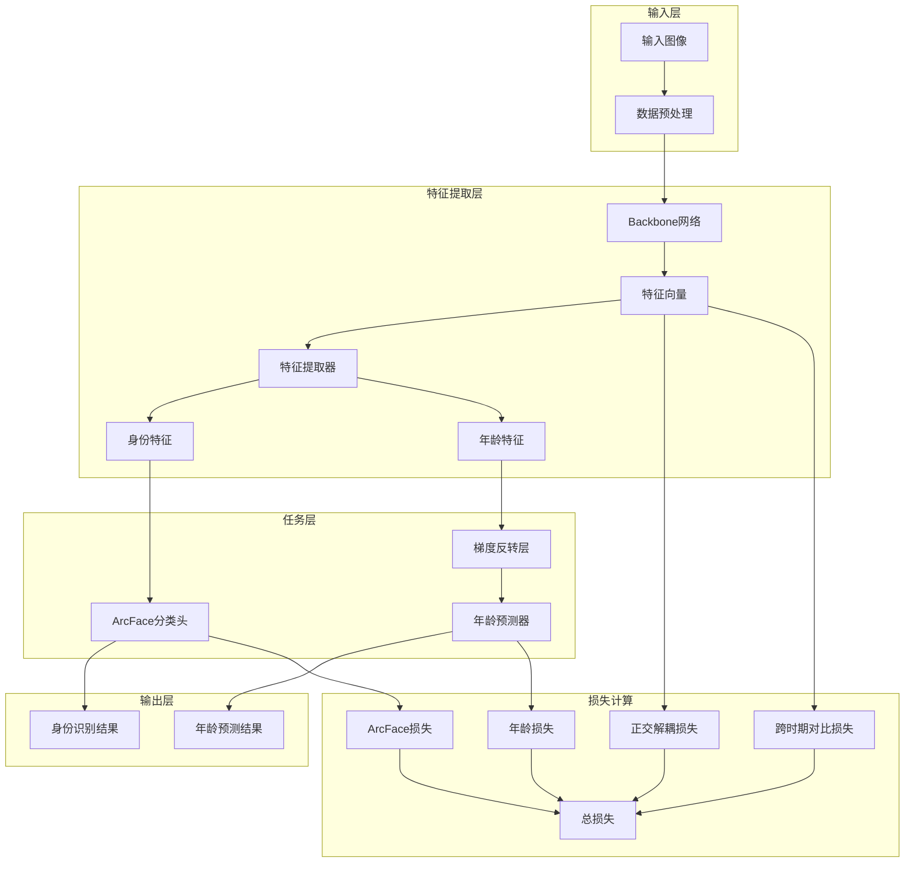

# 跨年龄人脸识别技术路线文档

## 1. 项目概述

本项目旨在构建一个跨年龄人脸识别系统，通过深度学习方法解决不同年龄段人脸差异带来的识别挑战。系统采用多任务学习架构，结合身份识别和年龄预测，利用梯度反转层实现域适应，提高跨年龄人脸识别的准确性。

## 2. 技术架构

### 2.1 整体架构



### 2.2 核心组件

#### 2.2.1 特征提取器

项目使用Swin Transformer作为特征提取器：

- 支持Swin-Tiny (swin_t)模型
- 利用Transformer架构捕获全局特征
- 添加全连接层将原始特征维度映射到指定嵌入维度

#### 2.2.2 ArcFace分类头

- 实现ArcFace损失函数，增强类间分离度
- 支持自定义margin和scale参数
- 特征和权重归一化，计算余弦相似度

#### 2.2.3 年龄预测器

- 两层全连接网络结构
- 输出年龄组分类结果
- 与身份识别任务共享特征提取器

#### 2.2.4 梯度反转层

- 实现域适应机制
- 在反向传播时反转梯度符号
- 动态调整反转强度（lambda值）

#### 2.2.5 正交解耦策略

- 实现身份特征和年龄特征的正交解耦
- 减少身份特征和年龄特征之间的相关性
- 提高模型对年龄变化的鲁棒性
- 采用projection方法实现正交解耦（由于decoupling方法实际测试效果不如projection，故选择了projection而放弃了decoupling）

#### 2.2.7 跨时期对比损失

- 计算不同时期（年龄段）样本之间的对比损失
- 增强模型对同一身份不同年龄段的识别能力
- 提高跨年龄人脸识别的准确率

## 3. 数据处理

### 3.1 数据预处理

```python
# 训练数据增强
train_transform = transforms.Compose([
    transforms.Resize((256, 256)),
    transforms.RandomCrop(224),
    transforms.RandomHorizontalFlip(p=0.5), # 水平翻转增强
    transforms.RandomRotation(15), # 随机旋转±15度
    transforms.RandomAffine(0, translate=(0.1, 0.1), scale=(0.9, 1.1)), # 随机平移和缩放
    transforms.ColorJitter(brightness=0.1, contrast=0.1, saturation=0.1, hue=0.05), # 缓解背景影响
    transforms.RandomEqualize(p=0.2), # 直方图均衡化，应对光照变化
    transforms.ToTensor(),                    
    transforms.RandomErasing(p=0.5), # 模拟遮挡
    transforms.GaussianBlur(kernel_size=(5, 9), sigma=(0.1, 5)), # 模拟低画质/失焦
    transforms.Normalize(mean=[0.485, 0.456, 0.406],
                         std=[0.229, 0.224, 0.225])
])

# 测试数据预处理
test_transform = transforms.Compose([
    transforms.Resize((224, 224)),
    transforms.ToTensor(),                    
    transforms.Normalize(mean=[0.485, 0.456, 0.406],
                         std=[0.229, 0.224, 0.225])
])
```

### 3.2 数据加载

- 支持从CSV文件加载数据集
- 支持图像预加载到内存，提高训练速度
- 批量加载和并行处理
- 支持IdentityPeriodSampler采样器，保证对比损失的有效对采样
- 根据批次大小自动调整每个身份的样本数（K值）

## 4. 训练策略

### 4.1 优化器

采用AdamW优化器，对不同组件使用不同学习率：

- Backbone网络：较低学习率（如2e-4）
- 分类头和年龄预测器：较高学习率（如2e-3）

### 4.2 学习率调度

使用带有线性预热的余弦退火学习率调度器：

- 初始学习率按配置设置
- 前几个epoch进行线性预热，防止Transformer早期崩塌
- 随训练轮次逐渐降低
- 最低学习率设置为1e-7

### 4.3 早停机制

- 监控验证集上的TAR@FAR指标
- 当指标不再提升时触发早停
- 耐心值（patience）可配置（默认15）

### 4.4 动态参数调整

- 梯度反转强度（rev_lambda）随训练进程动态调整
- 从0开始，逐渐增加到配置值

## 5. 评估指标

### 5.1 主要指标

1. **TAR@FAR**：在特定误报率（FAR）下的正确接受率（TAR）
   - 默认评估FAR=0.1%时的TAR

2. **Rank-1准确率**：排名第一的预测结果正确的比例

### 5.2 训练监控

- 训练损失（总损失、ArcFace损失、年龄损失、正交损失、跨时期对比损失）
- 训练准确率
- 学习率变化
- 验证集TAR@FAR

## 6. 技术亮点

### 6.1 多任务学习

- 同时学习身份识别和年龄预测任务
- 共享特征提取器，提高特征表示能力

### 6.2 域适应

- 利用梯度反转层实现年龄域适应
- 减少年龄因素对身份识别的影响

### 6.3 先进的Backbone选择

- 使用Swin Transformer作为Backbone网络
- 利用Transformer架构捕获全局特征，提高跨年龄识别性能

### 6.4 详细的训练监控

- 实时记录训练指标
- 生成训练过程可视化图表
- 保存最佳模型和检查点

## 7. 配置说明

### 7.1 模型配置

```yaml
model:
  backbone: swin_t  # 特征提取器类型: swin_t
  embedding_size: 768  # 嵌入维度
  arcface:
    margin: 0.55  # ArcFace margin参数
    scale: 32.0  # ArcFace scale参数
  dropout: 0.7  # Dropout概率
  period_loss_weight: 0.15  # 时期损失权重
  orthogonal_strategy: projection  # 正交解耦策略: projection
  orthogonal_loss_weight: 0.1  # 正交损失权重
```

### 7.2 训练配置

```yaml
training:
  num_epochs: 100  # 训练轮次
  batch_size: 32  # 批次大小
  learning_rate:
    backbone: 2e-4  # Backbone学习率
    head: 2e-3  # 分类头学习率
  weight_decay: 1e-3  # 权重衰减
  momentum: 0.9  # 动量
  scheduler: cosine  # 学习率调度器
  rev_lambda: 0.1  # 梯度反转参数
  patience: 20  # 早停耐心值
  stage: pretrain  # 训练阶段: pretrain, finetune
  pretrained_path: ../latest_checkpoint.pth  # 预训练权重路径
```

### 7.3 数据配置

```yaml
data:
  csv_path: ./data/MFD_metadatas.csv  # 数据集路径
  preload_image: true  # 是否预加载图像到内存
  pre_dataset: true  # 是否使用预处理数据集
```

## 8. 部署与推理

### 8.1 模型导出

- 训练完成后保存最佳Backbone权重
- 导出文件名为`backbone_{backbone}_{orthogonal_strategy}_for_inference.pth`，包含backbone类型和正交策略信息
- 保存完整模型检查点为`latest_checkpoint.pth`

### 8.2 推理流程

1. 加载预训练Backbone模型
2. 输入图像预处理
3. 提取特征向量并归一化
4. 计算特征相似度
5. 基于相似度进行身份匹配

### 8.3 性能优化

- 使用批量推理提高处理速度
- 特征计算和相似度计算支持分块处理，避免内存溢出
- 使用float32进行全精度计算，避免半精度计算导致的精度损失
- 支持CUDA加速（如可用）

## 9. 实验结果

### 9.1 训练监控

训练过程中记录以下指标：
- 训练损失曲线（总损失、ArcFace损失、年龄损失、正交损失、跨时期对比损失）
- 训练准确率曲线
- 验证集TAR@FAR曲线
- 学习率变化曲线
- 正交损失单独放大曲线

### 9.2 评估结果

模型在测试集上的表现：
- Rank-1准确率
- TAR@FAR=0.1%
- 不同年龄段的识别性能

## 10. 未来改进方向

1. **模型优化**：
   - 尝试更先进的Backbone网络（如EfficientNet、Swin Transformer）
   - 探索轻量级模型设计，提高推理速度

2. **数据增强**：
   - 增加更多针对年龄变化的图像增强策略
   - 利用生成对抗网络（GAN）生成跨年龄样本

3. **损失函数**：
   - 探索其他度量学习损失函数（如Triplet Loss、Circle Loss）
   - 设计更有效的多任务损失函数组合

4. **域适应**：
   - 引入更复杂的域适应方法
   - 考虑年龄域的连续性质，使用回归而非分类

5. **部署优化**：
   - 模型量化和剪枝
   - 边缘设备部署方案

## 11. 代码结构

```
Cross-time-face-recognition/
├── code/
│   ├── main.py                 # 主训练和测试脚本
│   ├── models.py               # 模型定义
│   ├── mydataset.py            # 数据集加载
│   ├── sampler.py              # 采样器实现
│   ├── preprocess_optimized.py # 优化的预处理策略
│   ├── transfer_learning.py    # 迁移学习实现
│   ├── progressive_transfer.py # 渐进式迁移学习
│   ├── eval_zeroshot.py        # 零样本评估
│   └── test_script.py          # 测试脚本
├── configs/
│   ├── config_3090.yaml        # 3090配置文件
│   ├── config_4060.yaml        # 4060配置文件
│   ├── config_progressive.yaml # 渐进式迁移配置
│   └── config_finetune.yaml    # 微调配置
├── data/                # 数据集目录
├── logs/                # 日志目录
├── scripts/             # 脚本目录
└── training_plots/      # 训练可视化图表
```

## 12. 运行说明

### 12.1 环境要求

- Python 3.8+
- PyTorch 2.0+
- torchvision
- PIL
- matplotlib
- numpy
- yaml

### 12.2 训练命令

```bash
python code/main.py --config configs/config_3090.yaml
```

### 12.3 测试命令

训练完成后，模型会自动进行测试。也可单独运行测试：

```bash
# 修改main.py中的do_train=False, do_test=True后运行
python code/main.py --config configs/config_3090.yaml
```

## 13. 总结

本项目实现了一个完整的跨年龄人脸识别系统，采用多任务学习、域适应技术和正交解耦策略，有效提高了不同年龄段人脸的识别准确率。系统具有以下特点：

- **先进性**：使用Swin Transformer作为Backbone，采用ArcFace损失、梯度反转层和正交解耦策略等先进技术
- **可监控性**：详细的训练监控和可视化
- **可扩展性**：模块化设计，易于添加新功能和改进

通过本技术路线，可以构建一个高性能的跨年龄人脸识别系统，适用于安防、身份验证、视频监控等多种应用场景。